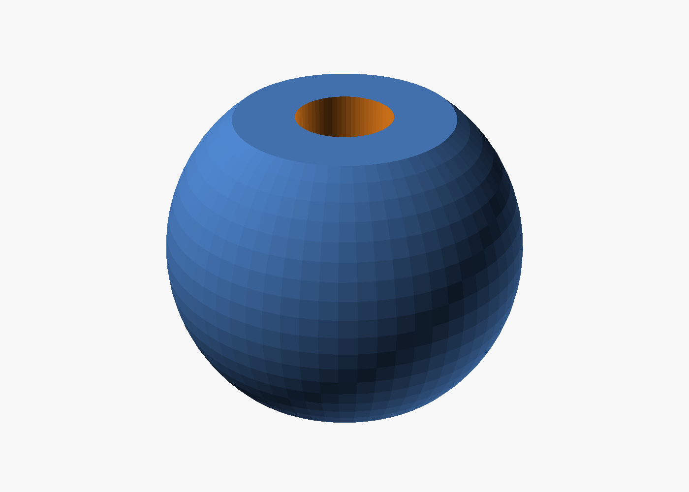
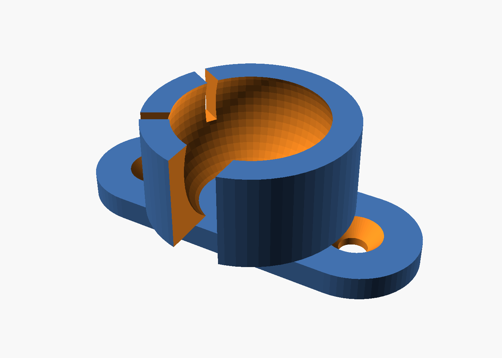

# Carcasa triangular del equipo del aula

Caja imprimible para el ESP32 del aula (circuito del `firmware/README.md`), hecha en OpenSCAD y paramétrica: todas las medidas son variables al principio de `carcasa_aula.scad`.

> **220 V:** el armado, el cableado de 220 V y la primera prueba conectada a la red se hacen con supervisión del profesor.


## Cómo es

- **Forma:** visto desde arriba es un triángulo rectángulo isósceles. El **frente** (el lado largo) tiene todas las conexiones; los dos **lados cortos** forman 90°, así que la caja entra justo en una esquina.
- **Dónde se pone:** apoyada en una mesa, atornillada a la pared por el piso (3 agujeros) o atornillada en una esquina por los lados cortos (1 agujero en cada uno). Los tornillos van de adentro hacia afuera.
- **Medidas exteriores:** 246 × 126 × 46 mm. Interior: frente de 240 mm, 40 mm de alto útil.
- **Tapa:** plana, apoya en un rebaje de las paredes y queda al ras. Se atornilla con 3 tornillos M3 en las esquinas.
- **Zonas:** una pared interna, que llega hasta la tapa, separa la zona de **220 V** (derecha, mirando el frente) de la de **baja tensión** (izquierda). Arriba de esa pared hay una muesca para pasar solo los cables de baja tensión: el control del relé y los 5 V de la fuente.


### Frente (de izquierda a derecha)

| Lugar | Qué va |
| :--- | :--- |
| Ventanas J2 y J1 | Conectores JST-XH de 2 pines de las cápsulas de los LEDs (baja tensión) |
| Ventana redonda chica | Receptor IR KY-022 (para aprender códigos de los controles) |
| Ventana rectangular | Ficha USB del ESP32: se programa sin abrir la caja |
| Agujero grande | Portafusible de chasis 5×20 |
| Dos agujeros grandes | Prensacables PG7: entrada de 220 V y salida a la lámpara |


Los agujeros redondos tienen forma de gota (punta arriba) para imprimir sin soportes.

### Seguridad de 220 V

- Pared interna entre la zona de 220 V y la de baja tensión.
- Los cables de 220 V entran y salen solo por prensacables PG7, que además los sujetan (si se tira del cable, no se afloja ningún borne).
- Lugar para el portafusible, en el frente: el fusible se cambia sin abrir la caja.
- Ranuras de ventilación de 2 mm, solo en el lado corto de la zona de 220 V (no entra un dedo ni un alambre grueso).
- Ningún borne de 220 V queda accesible desde afuera. Los tornillos de la tapa y los de fijación entran en plástico, lejos de los bornes.
- El texto "220 V" queda grabado en el frente, arriba del portafusible y los prensacables.

### LEDs IR movibles (cápsulas con rótula)

 

- **Cápsula:** cada LED va en una bola de 20 mm. El LED entra desde abajo hasta que la pestaña toca un escalón, y la cabeza sale por arriba. Las patas y el cable quedan adentro; se fijan con un poco de plástico caliente (pistola de silicona).
- **Rótula:** la bola encastra a presión en una rótula de la tapa. Gira para apuntar al aire o al proyector y queda firme por rozamiento. El borde tiene cortes para que flexione, y el corte más ancho es por donde sale el cable.
- **Para alejarla:** se saca la bola de la tapa, se pone en el **soporte** (pieza aparte, con 2 tornillos o cinta doble faz) y se usa un cable de extensión. No hace falta soldar.
- **Cables:** de cada cápsula sale un cable corto con un conector **JST-XH hembra de 2 pines**, que se enchufa en J1 o J2 del frente. La caja no se abre para cambiarlas.
- **Extensión:** un cable JST-XH macho-hembra de 2 pines, de los que se venden como "extensión para balanceador de baterías LiPo", del largo que haga falta.

### Cableado de los 2 LEDs en serie con las cápsulas separadas

El circuito sigue siendo el mismo (los 2 LEDs en serie con el BC337). Los conectores J1 y J2 están "en el medio" de la serie:

```
5 V ── (33 Ω ∥ 100 Ω) ──► J1 pin 1 ──[cápsula 1: ánodo → LED1 → cátodo]──► J1 pin 2
                                                                               │  (puente en la plaquita)
                          J2 pin 1 ◄───────────────────────────────────────────┘
                          J2 pin 1 ──[cápsula 2: ánodo → LED2 → cátodo]──► J2 pin 2 ──► colector BC337
```

- En la plaquita: pin 1 de J1 a las resistencias, pin 2 de J1 unido al pin 1 de J2, y pin 2 de J2 al colector del BC337.
- En cada cápsula: pin 1 = ánodo (pata larga), pin 2 = cátodo (pata corta, lado plano). Marcá el pin 1 en el conector.
- La serie pasa por las dos cápsulas: si falta una, no prende ninguna. Es a propósito.
- **No pongas un puente en lugar de una cápsula:** con un solo LED la corriente sube a ~135 mA, más de lo que aguanta un LED IR común (100 mA).

## Medidas para confirmar con calibre

Las variables marcadas `(CALIBRE)` en `carcasa_aula.scad` vienen con medidas típicas. Antes de imprimir, medí tus piezas y cambiá las que no coincidan:

| Pieza | Qué medir | Variable | Valor por defecto |
| :--- | :--- | :--- | :--- |
| ESP32 NodeMCU 30 pines | ancho y largo de la placa | `esp32` | 28,3 × 51,5 |
| | alto de las patas por debajo de la placa | `esp32_pines` | 9 |
| | ancho y alto de la ficha USB (con el cable enchufado) | `usb_ventana` | 12 × 8 |
| Fuente HLK-5M05 | largo, ancho y alto | `hlk` | 34 × 20 × 15 |
| Módulo relé | ancho y largo de la placa | `rele` | 26 × 50 |
| | posición de los agujeros desde una esquina | `rele_agujeros` | (3,3) (23,3) (3,47) (23,47) |
| KY-022 | ancho y alto de la plaquita | `ky022` | 18,5 × 15 |
| | altura del centro del receptor desde abajo | `ky022_z` | 9 |
| | cuánto sobresale el receptor de la plaquita | `ky022_separacion` | 5 |
| Plaquita perforada | ancho y profundidad | `perf` | 30 × 20 |
| Prensacables PG7 | diámetro de la rosca | `pg7` | 12,7 |
| Portafusible de chasis | diámetro del agujero que pide | `portafusible` | 12,5 |
| Conector JST-XH 2 pines (macho) | ancho y alto del encapsulado | `jst_ventana` | 8,2 × 6,8 |
| LED IR de 5 mm | diámetro del cuerpo y de la pestaña | `led_d`, `led_pestana` | 5 y 5,8 |

La tolerancia de los encastres es `holgura = 0.3`. Si tu impresora deja las piezas justas, subila a 0,4.

## Cómo cambiar las medidas

1. Instalá OpenSCAD (openscad.org; con la versión 2021.01 alcanza).
2. Abrí `carcasa_aula.scad` y cambiá los números de arriba del archivo. También se puede usar el Personalizador (menú Ventana → Personalizador).
3. Elegí qué ver con `pieza`: `"ensamble"`, `"interior"`, `"cuerpo"`, `"tapa"`, `"capsula"`, `"soporte"` o `"plano"`.
4. Para exportar una pieza: poné `pieza = "cuerpo"` e `imprimir = true`, renderizá con F6 y exportá con F7 (STL).

Desde la consola, todo de una vez:

```bash
for p in cuerpo tapa capsula soporte; do openscad --export-format binstl -o stl/$p.stl -D "pieza=\"$p\"" -D imprimir=true carcasa_aula.scad; done
```

Para las vistas previas, por ejemplo:

```bash
openscad -o vistas/ensamble.png -D 'pieza="ensamble"' --imgsize=1400,1000 --camera=0,30,35,58,0,25,520 --colorscheme=Tomorrow carcasa_aula.scad
```

## Impresión

| Pieza | Archivo | Tamaño | Cómo va en la cama |
| :--- | :--- | :--- | :--- |
| Cuerpo | `stl/cuerpo.stl` | 176 × 176 × 46 mm | Apoyado en el piso, con los lados cortos sobre los ejes de la cama (así entra en una de 220 × 220) |
| Tapa | `stl/tapa.stl` | 172 × 172 × 15 mm | Plana, con las rótulas para arriba |
| Cápsula (×2) | `stl/capsula.stl` | Ø20 × 15 mm | Sobre la cara plana de abajo, con el agujero del LED arriba |
| Soporte (opcional) | `stl/soporte.stl` | 44 × 26 × 15 mm | Plano, con la rótula para arriba |

- **Sin soportes:** ninguna pieza los necesita. Los agujeros del frente tienen forma de gota, la bola está cortada a 7 mm del centro (inclinación de 44°) y las ventanas rectangulares son puentes cortos.
- **Material:** PETG o ASA antes que PLA. El PLA se ablanda cerca de los 55 °C, y la fuente y el relé calientan adentro de una caja cerrada (y un aula al sol se calienta mucho). Si consiguen un filamento ignífugo (V-0, por ejemplo PC-FR o ABS-FR), es lo mejor para una caja con 220 V.
- **Parámetros sugeridos:** capa de 0,2 mm, 4 perímetros (así las paredes de 3 mm salen macizas), relleno del 25 al 30 % (giroide) y 5 capas arriba y abajo. Para las cápsulas y las rótulas, 100 % de relleno o 5 perímetros, así el encastre no se rompe.

## Lista de compras

- 2 prensacables PG7 (para cables de 3 a 6,5 mm).
- 1 portafusible de chasis 5×20 y el fusible. El fusible se elige según la lámpara, y nunca de más corriente que la que aguanta el relé o el cable; definilo con el profe.
- 2 conectores JST-XH de 2 pines macho (en la plaquita) y 2 hembra (en los cables de las cápsulas), y, si hace falta, cables de extensión JST-XH macho-hembra.
- 2 LEDs IR de 5 mm y cable fino de 2 hilos.
- Tornillos: 3 M3 × 10 autorroscantes (tapa), 4 M3 × 6 autorroscantes (relé) y 4 M2,5 o M3 × 6 (plaquita).
- 2 o 3 tornillos de 4 mm con tarugos de 6 mm, para la pared o la esquina.
- 1 precinto chico para la fuente, 2 borneras tipo Wago para el neutro y la fase, y plástico caliente para las cápsulas.

## Armado

1. **Prueba en seco (sin 220 V):** presentá las piezas en la caja y confirmá que entran: el ESP32 sobre sus rieles con el USB en la ventana, el KY-022 parado en su ranura con el receptor en la ventana redonda, la plaquita en sus postes y el relé en los suyos.
2. **Baja tensión:**
   - Atornillá la plaquita.
   - Pegá o atornillá los dos conectores JST-XH contra las ventanas J1 y J2 (por ejemplo, en un pedacito de plaquita con plástico caliente).
   - Cableá el ESP32, el KY-022 y el BC337 según el `firmware/README.md`.
3. **Cápsulas:**
   - Soldá cada LED a su cable con el conector JST-XH hembra (pin 1 = ánodo) y aislá con termocontraíble.
   - Pasá el LED desde abajo de la bola hasta que haga tope y fijalo con plástico caliente.
   - Encastrá la bola en la rótula, con el cable saliendo por el corte ancho, y enchufalo en J1 o J2.
4. **220 V (con el profe):**
   - Atornillá el relé en sus postes, con las borneras del lado del frente.
   - Poné la fuente en su cuna y sujetala con el precinto por las ranuras.
   - Pasá los cables por los prensacables y ajustalos.
   - Fase: entrada → portafusible → COM del relé y fase de la fuente; NO del relé → lámpara. El neutro va directo a la lámpara y a la fuente (con borneras).
   - Los cables de baja tensión (5 V de la fuente e IN, VCC y GND del relé) pasan a la zona de baja tensión solo por la muesca de la pared.
5. **Cierre:** antes de atornillar la tapa, revisá que ningún cable de 220 V cruce a la zona de baja tensión. Después, la tapa con 3 tornillos M3.
6. **Fijación:** apoyala en la mesa, o atornillala a la pared (por el piso) o a una esquina (por los lados cortos), con el frente a la vista.
