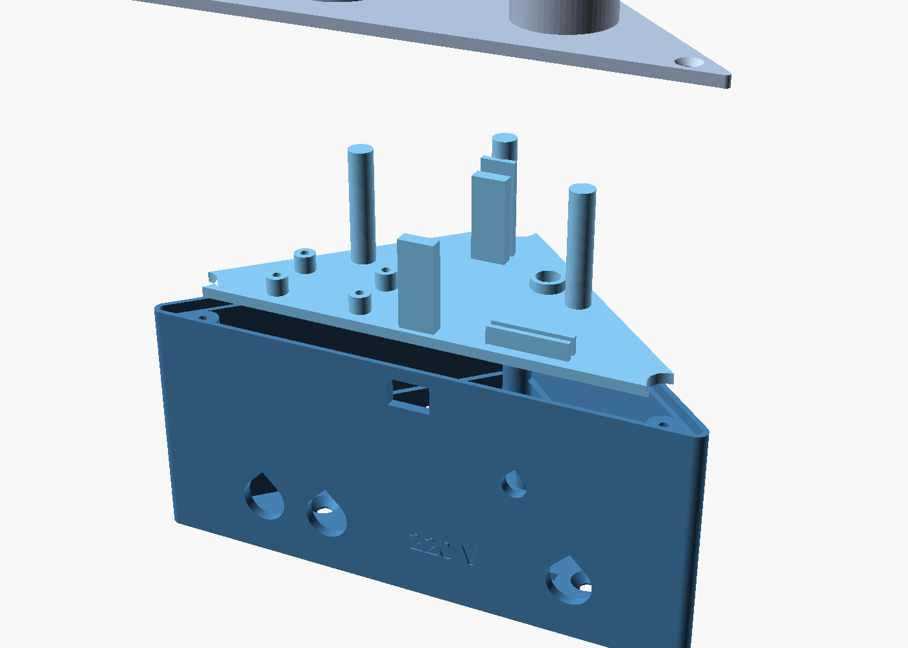
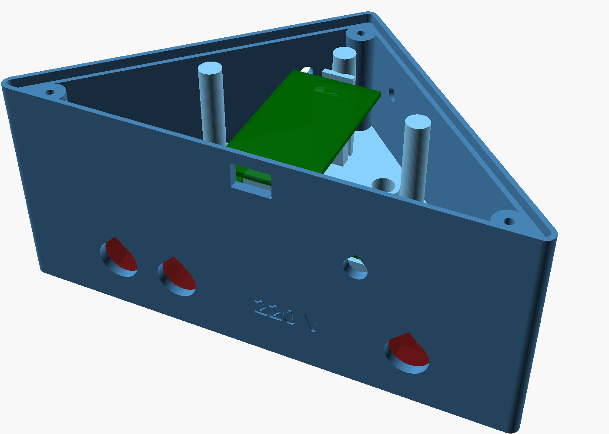
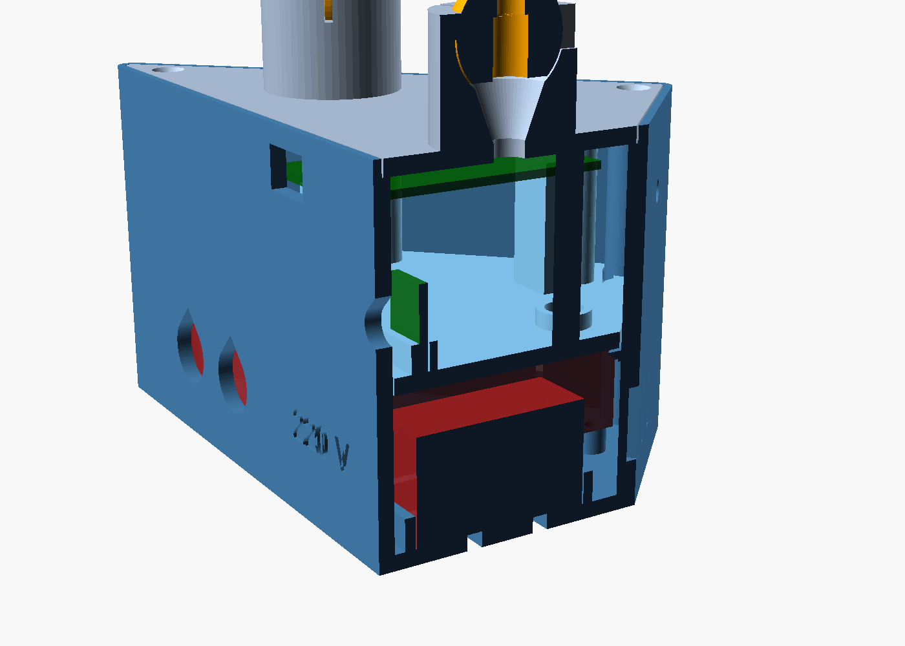
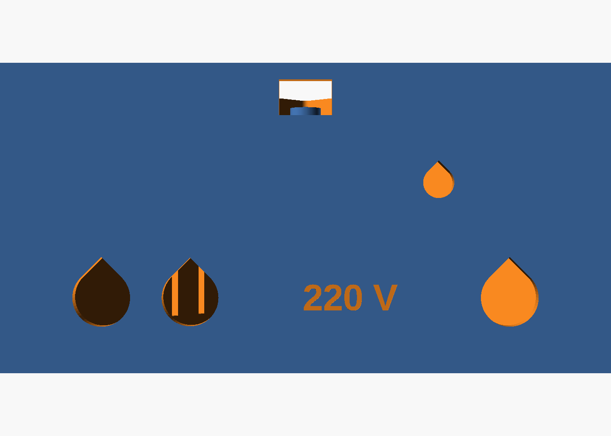
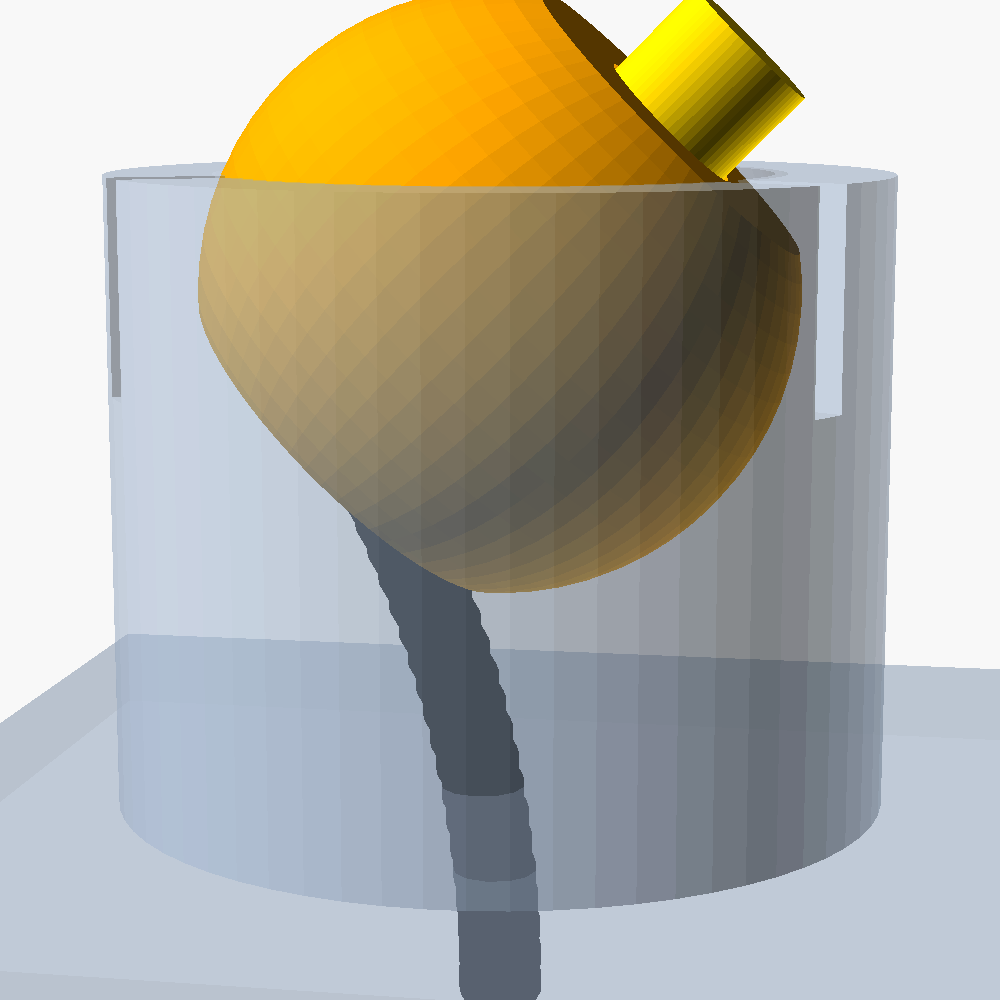

# Carcasa triangular del equipo del aula (dos pisos)

Caja imprimible para el ESP32 del aula y el circuito ya soldado del `firmware/README.md`. Está hecha en OpenSCAD y es paramétrica: todas las medidas son variables al principio de `carcasa_aula.scad`.

> **220 V:** el armado, el cableado de 220 V y la primera prueba conectada a la red se hacen con supervisión del profesor.



## Medidas finales

| Pieza | Medidas (mm) | Entra en |
| :--- | :--- | :--- |
| Cuerpo | 158 × 82 × **70** de alto | Círculo de Ø158 |
| Bandeja | 134 × 71 × 36 | Ø134 |
| Tapa (con las rótulas) | 154 × 78 × 24 | Ø154 |
| Cápsula y tapón | Ø20 × 15 | Ø20 |
| Soporte | 48 × 26 × 24 | Ø48 |

- **Cama redonda de 170 mm:** todas las piezas entran en un círculo de 160 mm, con margen. Las triangulares se apoyan con el frente sobre un diámetro de la cama.
- **Pieza más alta: el cuerpo, de 70 mm.** Tu impresora tiene que llegar por lo menos a esa altura.
- **Armada:** la caja mide 70 mm. Con las rótulas y las cápsulas llega a unos 99 mm.
- **Por dentro:**
  - el frente mide 152 mm y el fondo 76 mm;
  - el piso de abajo (220 V) tiene 28 mm de alto;
  - el piso de arriba (baja tensión) tiene 33 mm.

## Cómo es

- **Forma:** visto desde arriba es un triángulo rectángulo isósceles. El **frente** (el lado largo) tiene todas las conexiones. Los dos **lados cortos** forman 90°, así que la caja entra justo en una esquina.
- **Dónde se pone:** apoyada en una mesa, atornillada a la pared por el piso (2 agujeros) o atornillada en una esquina por los lados cortos (1 agujero en cada uno, en el piso de arriba).
- **Dos pisos:** por el espacio que da la cama no entra todo en uno.
  - **Abajo, 220 V:** la fuente HLK-5M05 (parada, apoyada en un costado), el relé, el portafusible de chasis y los 2 prensacables PG7.
  - **En el medio, la bandeja:** separa los pisos y hace de pared de 220 V. Tiene un solo paso chico, de 7 mm, para los cables de baja tensión: 5 V, GND y la señal del relé. Apoya en una repisa de las paredes y se saca para armar y cablear.
  - **Arriba, baja tensión:** el ESP32, la plaquita del BC337 y el KY-022.
  - **La tapa:** lleva las dos rótulas de los LEDs y se atornilla con 3 tornillos M3 en las esquinas.
- **Cómo queda trabada la bandeja:** tiene 3 columnas que llegan justo a la tapa. Al atornillar la tapa, la bandeja queda apretada contra la repisa. Sacando la tapa, la bandeja sale.




### Frente

| Lugar | Qué va |
| :--- | :--- |
| Abajo a la izquierda | Prensacables PG7 de **entrada** de 220 V y el **portafusible** |
| Abajo a la derecha | Prensacables PG7 de **salida** a la lámpara |
| Arriba, al medio | Ficha **USB** del ESP32: se programa sin abrir la caja |
| Arriba a la derecha | Ventana del receptor **KY-022**, para aprender códigos de los controles |



Los agujeros redondos tienen forma de gota, con la punta arriba, para imprimir sin soportes.

### ESP32 con las fichas hembra puestas

El ESP32 apoya en dos tacos, uno en cada punta de la placa (las puntas no tienen patas), a 25 mm de la bandeja. Debajo queda lugar para las fichas hembra (dupont) y el cable doblado. Los tacos están en el medio, así que los cables salen libres por los dos costados. Un tope atrás evita que la placa se corra, y el USB queda a la altura de su ventana. Si querés que no se mueva, poné una gota de plástico caliente en cada taco.

### LEDs IR: cápsulas con rótula y cable soldado

- **Cápsula:** cada LED va en una bola de 20 mm. El LED entra desde abajo hasta que la pestaña toca un escalón, y la cabeza sale por arriba.
- **Cable:** sale derecho por abajo de la bola. Baja por un embudo de unos 10 mm dentro de la rótula y entra a la caja por un agujero de 6 mm de la tapa, justo debajo. Se curva suave, sin doblarse a 90°. Toda la tapa está sobre el piso de baja tensión.
- **Giro:** la bola gira **50° para cualquier lado**, también derecho para arriba (para los aires, que están altos). Está comprobado en OpenSCAD: a 55° la cabeza del LED toca el borde. En la mitad de arriba la rótula aprieta la bola 0,1 mm, así que queda apuntando donde la dejás. Si queda muy dura o muy floja, cambiá `rotula_apriete`.
- **Alivio de tensión:**
  - adentro de la caja, ajustá un precinto alrededor del cable justo debajo del agujero de la tapa: hace de tope y, si alguien tira del cable, no se tira de las soldaduras de la plaquita;
  - dejá un poco de cable enrollado adentro.
- **Para alejar una cápsula:**
  1. Sacá la bola de la rótula.
  2. Cortá el precinto, tirá el largo de cable que haga falta y poné otro precinto.
  3. Poné la bola en el **soporte** (2 tornillos o cinta doble faz; el cable sale por un costado de la base).
  4. En la rótula que quedó vacía poné un **tapón**: tiene un agujero chico por donde pasa el cable.
- **Tapones:** sirven también para tapar una rótula que no se use.



### Seguridad de 220 V

- Todo el 220 V está en el piso de abajo. La bandeja lo separa de la baja tensión y solo tiene un paso chico, para los cables de baja tensión.
- Los cables de 220 V entran y salen solo por prensacables PG7, que además los sujetan: si se tira del cable, no se afloja ninguna conexión.
- Hay ranuras de ventilación de 2 mm solo en el piso de 220 V; no entra un dedo ni un alambre grueso.
- Ningún borne de 220 V queda accesible desde afuera. El portafusible de chasis se abre desde afuera solo para cambiar el fusible.
- El texto "220 V" queda grabado en el frente.
- **Se comprobó en OpenSCAD** que, por dentro, el portafusible (30 mm más los terminales) y las tuercas de los PG7 no chocan con la fuente ni con el relé, ni con el cuerpo ni con la bandeja: la vista `pieza = "choques"` sale vacía.

## Conexiones de 220 V

El fusible protege **solo la fuente HLK-5M05**. A la lámpara la protege la térmica del tablero del aula.

```
ENTRADA (PG7 de entrada)                                   SALIDA a la lámpara (PG7 de salida)

Fase (L) ──► terminal de entrada del portafusible ─┬─ fusible T1A ──► HLK-5M05 "AC" (L)
                                                   └────────────────► COM del relé
                                                                      NO del relé ──────► Fase de la lámpara
Neutro (N) ──► empalme soldado ─┬───────────────────────────────────► HLK-5M05 "AC" (N)
                                └───────────────────────────────────► Neutro de la lámpara
                                                                      (NC del relé: sin usar)
HLK-5M05 "+Vo" (5 V) y "-Vo" (GND) ──► pasan a la bandeja por el paso de cables ──► ESP32 y relé
```

- **Dónde se divide la fase:** en el terminal de entrada del portafusible. Ahí se sueldan dos cables: el que viene de la entrada y el que va al COM del relé. Así no hace falta una bornera.
- **Empalme del neutro:** soldado y con dos capas de termocontraíble.
- **Fusible:** **5×20 mm, 1 A, 250 V, lento (T1A)**.
  - La hoja de datos de la serie HLK-5M recomienda en la entrada un fusible de 1 A / 250 Vac de acción lenta (o una resistencia bobinada de 10 Ω).
  - La HLK-5M05 consume como mucho 0,2 A, pero al enchufarla tiene un pico de hasta 10 A. Por eso el fusible es lento: uno rápido o más chico se quemaría al encenderla.
- **Antes de conectar, revisá que el relé aguante la corriente de las luces:**
  - Los módulos comunes (relé SRD-05VDC-SL-C) dicen 10 A a 250 V; lo dice el propio relé, en la tapa.
  - Corriente de las luces = potencia total ÷ 220 V. Por ejemplo, 6 tubos LED de 18 W = 108 W ≈ 0,5 A.
  - Las fuentes de las lámparas LED tienen un pico al encender. Si las luces suman más de unos 1000 W (≈ 4,5 A) o son muchas lámparas, consultalo con el profe antes de conectarlas a este relé.

## Medidas para confirmar con calibre

Las variables marcadas `(CALIBRE)` en `carcasa_aula.scad` vienen con medidas típicas. Medí tus piezas y cambiá las que no coincidan:

| Pieza | Qué medir | Variable | Valor por defecto |
| :--- | :--- | :--- | :--- |
| ESP32 (NodeMCU 30 pines) | ancho y largo de la placa | `esp32` | 28,3 × 51,5 |
| | alto de las fichas hembra con el cable doblado | `esp32_bajo` | 25 |
| | ancho y alto de la ficha USB con el cable enchufado | `usb_ventana` | 12 × 8 |
| HLK-5M05 | largo, ancho y alto | `hlk` | 34 × 20 × 15 |
| Relé | ancho y largo de la placa, alto del relé | `rele`, `rele_alto` | 26 × 50, 17 |
| | agujeros, desde una esquina | `rele_agujeros` | (3,3) (23,3) (3,47) (23,47) |
| KY-022 | ancho y alto de la plaquita | `ky022` | 18,5 × 15 |
| | altura del centro del receptor y cuánto sobresale | `ky022_z`, `ky022_separacion` | 9 y 5 |
| Plaquita del BC337 | ancho y profundidad | `perf` | 30 × 20 |
| Prensacables PG7 | diámetro de la rosca y tuerca entre puntas | `pg7`, `pg7_tuerca` | 12,7 y 22 |
| Portafusible de chasis | agujero que pide; diámetro y largo hacia adentro | `portafusible`, `portafusible_cuerpo` | 12,5; 13 × 38 |
| LED IR de 5 mm | cuerpo y pestaña | `led_d`, `led_pestana` | 5 y 5,8 |
| Cable de cada LED | grosor (tiene que pasar por el agujero de la tapa) | `cable_agujero` | 6 |

La tolerancia de los encastres es `holgura = 0.3`. Si tu impresora deja las piezas justas, subila a 0,4.

## Cómo cambiar las medidas

1. Instalá OpenSCAD (openscad.org; con la versión 2021.01 alcanza).
2. Abrí `carcasa_aula.scad` y cambiá los números de arriba del archivo.
3. Elegí qué ver con `pieza`. Las piezas son `"cuerpo"`, `"bandeja"`, `"tapa"`, `"capsula"`, `"tapon"` y `"soporte"`. Las vistas para mirar son:
   - `"ensamble"`;
   - `"interior"`;
   - `"corte"`;
   - `"rotula_giro"`;
   - `"choques"`: si cambiás medidas del piso de 220 V, renderizala con F6. Tiene que salir vacía.
4. Exportá cada pieza con F6 y F7 (STL). Cada pieza ya queda centrada para la cama redonda.

Desde la consola, todo de una vez:

```bash
for p in cuerpo bandeja tapa capsula tapon soporte; do openscad --export-format binstl -o para-imprimir/$p.stl -D "pieza=\"$p\"" carcasa_aula.scad; done
```

## Impresión

Lo que necesita quien imprime está en `para-imprimir/LEEME.txt`, junto con los STL finales. En resumen:
- se imprime en PETG (o ASA), con capa de 0,2 mm;
- ninguna pieza lleva soportes;
- el cuerpo mide 70 mm de alto.

## Lista de compras

Lo único nuevo es el fusible con su portafusible y los 2 prensacables. Lo demás (tornillos, cable, precintos, termocontraíble) conseguilo solo si no lo tienen.

| Qué | Medida | Cantidad |
| :--- | :--- | :---: |
| Fusible | 5×20 mm, **T1A** (1 A lento), 250 V | 2 (uno de repuesto) |
| Portafusible de chasis (de panel, con tuerca) | para fusible 5×20, agujero de 12 a 13 mm (si el tuyo pide otro, cambiá `portafusible`) | 1 |
| Prensacables PG7 con tuerca | rosca PG7 (12,5 mm), para cable de 3 a 6,5 mm | 2 |
| Tornillos para la tapa | M3 × 12, autorroscantes para plástico | 3 |
| Tornillos para el relé | M3 × 8, autorroscantes | 4 |
| Tornillos para la plaquita del BC337 | M2,5 × 6 o M3 × 6, autorroscantes | 4 |
| Tornillos y tarugos para fijarla | tornillo de 4 mm × 30 con tarugo de 6 mm | 2 (pared) o 2 (esquina) |
| Cable de entrada y salida de 220 V | 2 × 1 mm² (o 2 × 0,75 mm²) con doble aislación, redondo para que ajuste en el PG7 | el largo de la instalación |
| Cable para los puentes internos de 220 V | unipolar de 1 mm² | 50 cm |
| Cable de cada LED | 2 hilos finos (por ejemplo 2 × 0,25 mm²), de no más de 5 mm de grosor | 1,5 m por LED (con cable de sobra adentro) |
| Precintos chicos | 2,5 mm de ancho | 4 |
| Termocontraíble | 3 mm y 6 mm | 30 cm de cada uno |

## Armado

1. **Prueba en seco, sin 220 V:** presentá todo.
   - Relé en sus postes, con las borneras hacia el frente; la HLK parada en su cuna; el portafusible y los PG7 en el frente.
   - La bandeja en su repisa; el ESP32 en sus tacos con el USB en la ventana; el KY-022 en su ranura con el receptor en la ventana; la plaquita en sus postes.
2. **Piso de baja tensión (bandeja):**
   - Atornillá la plaquita y poné el ESP32 y el KY-022.
   - Pasá el cable de cada LED de abajo hacia arriba por el agujero de la tapa y por la rótula.
   - Soldá el LED (ánodo = pata larga), pasalo por la bola desde abajo y fijalo con plástico caliente.
   - Encastrá la bola. Abajo de la tapa, poné el precinto de alivio de tensión.
3. **Piso de 220 V (con el profe):**
   - Atornillá el relé y sujetá la HLK con un precinto por las ranuras del piso.
   - Pasá los cables por los PG7 y cableá como en el dibujo de arriba.
   - Pasá 5 V, GND y la señal del relé (IN) a la bandeja, solo por el paso de cables.
4. **Cierre:**
   - Revisá que ningún cable de 220 V pase al piso de arriba.
   - Apoyá la bandeja en la repisa y atornillá la tapa: las columnas de la bandeja la dejan trabada.
   - Ajustá los PG7.
5. **Fijación:** apoyala en la mesa, o atornillala a la pared (por el piso, con la bandeja afuera) o a una esquina (por los lados cortos del piso de arriba). Siempre con el frente a la vista.
